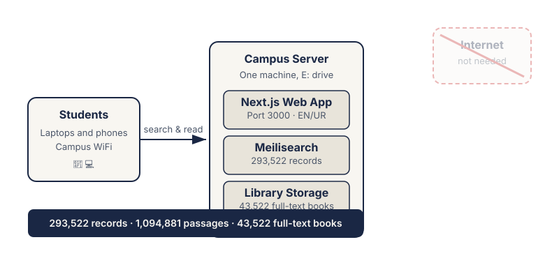

# CampusVerse: Offline Academic Library for Pakistani Universities

**Offline academic discovery engine for Pakistani universities.**

CampusVerse is a self-hosted search platform that puts a full academic library on a campus server. Students and faculty search, read, and cite books and statutes over the campus network. No internet connection required.

---

## 1. What is CampusVerse?

CampusVerse is an offline-first digital library system built for universities in Pakistan. It runs entirely on a local campus server: a Next.js web application backed by a Meilisearch search index, serving content over the campus LAN.

What it does:

- Full-text search across **293,522 catalog records**
- Instant reading of **43,522 full-text documents**
- Citation export in APA, MLA, and Chicago formats
- Personal shelves, reading history, and bookmarks
- Bilingual interface: English and Urdu (right-to-left)

What it does not need: internet access, cloud accounts, or per-seat licenses.

## 2. The problem

Campus internet in Pakistan is unreliable. Evening congestion, load shedding, and bandwidth caps cut students off from online libraries exactly when they need them most. Commercial academic databases charge per-seat fees in dollars, pricing out most public universities.

CampusVerse removes the internet from the critical path. The entire collection lives on a server inside the campus building. If the campus network is up, the library is up.

## 3. How it works

Three components, one server:

1. **Meilisearch** (127.0.0.1:7700): the search engine. Holds 293,522 catalog records and 1,094,881 full-text passages. Typo-tolerant search with millisecond response times.
2. **Next.js web app** (port 3000): the interface. Search, reader, shelves, citations, admin dashboard. Installable as a PWA for offline use.
3. **Library storage**: 43,522 original book files on local disk, streamed to readers on demand.

Deployment is one machine on the campus LAN. A firewall rule opens port 3000 to the local network. Students connect over WiFi using a QR code or URL. Nothing leaves the building.

## 4. The collection

Real numbers, verified against the live search index:

| Source | Documents | Access |
|---|---|---|
| Project Gutenberg | 43,514 books | Full text |
| OpenStax | 5 textbooks | Full text |
| Pakistani statutes | 3 (Companies Act 2017, Partnership Act 1932, Contract Act 1872) | Full text |
| Catalog records | 250,000 | Citation index |

**Total: 293,522 records. 1,094,881 full-text passages. 43,522 readable documents.**

Copyright compliance follows Pakistan Copyright Ordinance 1962, Section 18: literary works enter the public domain 50 years after the author's death. CampusVerse serves full text only for works verified public domain in Pakistan (author died in 1975 or earlier) or explicitly open-licensed (OpenStax textbooks, statutes). All other records are citation-only index entries.

## 5. For universities

**Pilot program:** free 30-day on-campus pilot. We install on your server, load the collection, and train your library staff.

**After the pilot:** PKR 350,000 per campus per year. One flat fee. Unlimited students, unlimited faculty, unlimited searches.

Contact: **Ahmad Bilal**, [github.com/AhmadBilalDSA](https://github.com/AhmadBilalDSA), kierninja@gmail.com

## 6. Technical overview

- **Frontend:** Next.js 15, React, TypeScript. Bilingual English/Urdu with RTL layout. Zero CDN dependencies; every asset is self-hosted.
- **Search:** Meilisearch. Faceted search, typo tolerance, filtered queries across catalog and full-text indexes.
- **Reader:** Paginated text reader with table of contents, PDF support for textbooks, download of original source files.
- **Auth:** Session-based login with rate limiting on all API routes.
- **Telemetry:** Privacy-preserving pilot analytics. Hour-bucketed counts only. No raw IP addresses, no user IDs.
- **Stack:** TypeScript, Python (ingestion), PowerShell (operations), SQLite.

---

*Built by Ahmad Bilal. CampusVerse is a product of independent research and development for Pakistani higher education.*
